  

  

  
  &nbsp;
  

I design and run enterprise AI on **Azure** and **Databricks**: retrieval, agents, evaluation, governance and the delivery pipelines that hold them together. My background runs from MI analysis through data science to MLOps and GenAI, so I look at the whole system, not only the model.

> **Open to** senior AI engineering roles, plus selected advisory and speaking work. &nbsp;→&nbsp; **[Get in touch](mailto:adeoluwa.adelugba@gmail.com)**

## About Me

- **Senior AI Engineer @ AI Ops Solutions** since 2021. I lead enterprise GenAI, agentic AI and MLOps delivery across insurance, finance, housing and enterprise operations.
- I take AI **from proof of concept to governed production**: ADRs, HLDs and LLDs, Git-based ALM, CI/CD, and nightly evaluations gated on accuracy.
- Previously **Data Scientist @ London & Quadrant**, building NLP, forecasting and propensity models, and before that analytics roles including the **Financial Ombudsman Service**.
- Founder of **Human-Centric AI Ltd**, which brings practical AI automation to small businesses in North East England.
- **MSc Quantitative Finance**, University of Glasgow.

## Featured Work

<table>
  <tr>
    <td width="50%" valign="top"></td>
    <td width="50%" valign="top"></td>
  </tr>
  <tr>
    <td width="50%" valign="top"></td>
    <td width="50%" valign="top"></td>
  </tr>
</table>

Client work is confidential, so these cards describe the architecture rather than link to code. Walkthroughs are available on request.

  

## Tech Stack

**GenAI & Agents**
     

**MLOps & LLMOps**
      

**Languages & Frameworks**
       

**Automation & Analytics**
   

## Certifications

     

## GitHub Stats

  

  

<i>Building AI that has to work beyond the demo?</i> &nbsp;&nbsp; <a href="https://www.linkedin.com/in/adeoluwa-adelugba-58a96329/"><b>Let's talk</b></a>

North East England &nbsp;·&nbsp; <a href="https://www.linkedin.com/in/adeoluwa-adelugba-58a96329/">LinkedIn</a> &nbsp;·&nbsp; <a href="mailto:adeoluwa.adelugba@gmail.com">Email</a> &nbsp;·&nbsp; README assets generated by <code>scripts/build-assets.mjs</code>

